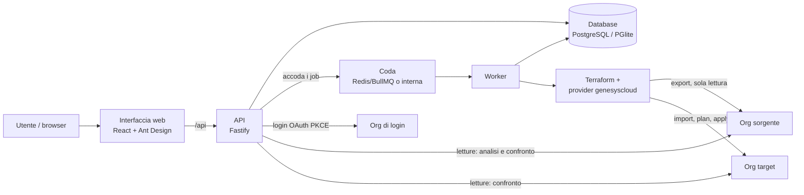
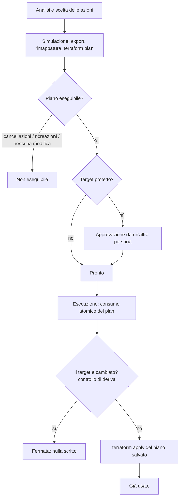

# Genesys Cloud Promote – Documento architetturale

Versione allineata al documento su Claude: https://claude.ai/artifact/KLzAb4mdnGFgyC41EqKgYb
(i diagrammi sono riportati qui in Mermaid).

Genesys Cloud Promote porta oggetti Genesys Cloud da un'org all'altra (dev → test → prod) solo attraverso un plan simulato, approvato se il target è protetto ed eseguito una sola volta. La Parte 1 mostra l'architettura in forma schematica; la Parte 2 la spiega componente per componente.

## Parte 1 – Architettura in sintesi

### Panoramica

L'applicazione legge gli oggetti da un'org sorgente, ne ricostruisce l'albero delle dipendenze, li confronta con un'org target e ne fa il porting con CX as Code (Terraform), sotto controllo di permessi e approvazioni.

| Attore | Cosa fa |
| --- | --- |
| Utente (consulente) | Analizza, sceglie cosa portare, crea la simulazione (plan) |
| Esecutore | Esegue un plan pronto (permesso *esegue*) |
| Approvatore | Approva i plan verso ambienti protetti; non può approvare i propri (permesso *approva*) |
| Org di login | Org Genesys usata solo per autenticare gli utenti |
| Org sorgente | Da dove si leggono ed esportano gli oggetti (sola lettura) |
| Org target | Dove gli oggetti vengono creati o aggiornati |

Ogni org è un **ambiente** dell'applicazione, con il proprio OAuth client. Un ambiente può essere *solo sorgente* (mai scritto) o *protetto* (plan con approvazione obbligatoria, tipicamente la produzione).

### Componenti

L'API legge le org per l'analisi e accoda i job; solo il worker esegue Terraform, legge dal sorgente e scrive sul target.

### Flusso di rilascio

Ogni rilascio passa da una simulazione salvata; l'esecuzione la applica una sola volta, dopo l'eventuale approvazione e solo se il target non è cambiato. Stati del plan: *In corso*, *Fallita*, *Non eseguibile*, *Da approvare*, *Pronto*, *Già usato*, *Scaduto*.

### Componenti e tecnologie

| Componente | Tecnologia | Responsabilità |
| --- | --- | --- |
| Interfaccia web | React, Vite, TypeScript, Ant Design, TanStack Query | Login, ambienti, wizard di porting con albero delle dipendenze, plan, storico |
| API | Node.js 22, Fastify, TypeScript | Autenticazione, permessi, ambienti, analisi delle dipendenze, gestione dei job |
| Worker | Node.js, BullMQ (in locale: coda interna) | Esecuzione di simulazioni ed esecuzioni, un job alla volta |
| Motore di porting | Terraform + provider CX as Code `mypurecloud/genesyscloud` | Export dal sorgente, plan salvato, apply del plan sul target |
| Database | PostgreSQL + Drizzle ORM (in locale: PGlite) | Ambienti, job, plan cifrati, approvazioni, log, audit |
| Coda | Redis (solo in modalità server) | Passaggio dei job dall'API al worker |
| Platform API Genesys Cloud | REST | Letture per analisi e confronto, verifica delle credenziali |
| Login Genesys Cloud | OAuth 2.0 Authorization Code + PKCE | Identità e ruoli degli utenti |

Codice: monorepo [genesys-cloud-promote](https://github.com/ilrandagio/genesys-cloud-promote) con `apps/web` (interfaccia) e `apps/api` (API e worker).

## Parte 2 – Architettura in dettaglio

Ogni sezione descrive un aspetto dell'applicazione: cosa fa, come lo fa e quali garanzie offre.

### Autenticazione e autorizzazioni

Gli utenti entrano con il proprio account Genesys Cloud; cosa possono fare dipende dai ruoli Genesys letti al login.

**Login.** OAuth 2.0 Authorization Code con PKCE verso l'org di login, tramite un client di tipo *Code Authorization* (redirect `APP_URL/api/auth/callback`). State e verifier PKCE viaggiano in un cookie firmato valido 10 minuti. Dopo il login l'app legge il profilo e i ruoli (`/api/v2/users/me?expand=authorization`) ed emette una propria sessione: cookie JWT httpOnly di 8 ore. Il token Genesys dell'utente non viene conservato.

**Accesso.** Facoltativamente limitato a un ruolo Genesys (`GENESYS_LOGIN_REQUIRED_ROLE`) e/o a un elenco di email (`APP_ALLOWED_EMAILS`).

**Permessi di rilascio.** Calcolati al login e salvati nella sessione:

| Azione | Chi può farla |
| --- | --- |
| Analisi e simulazione | Qualunque utente autenticato |
| Esecuzione di un plan | Ruolo `GENESYS_APPLY_ROLE` o email in `APP_APPLY_EMAILS` (se entrambi vuoti: tutti) |
| Approvazione | Ruolo `GENESYS_APPROVER_ROLE` o email in `APP_APPROVER_EMAILS` (se entrambi vuoti: tutti), mai chi ha creato il plan |

Una modifica dei ruoli in Genesys vale dal login successivo. Lo stato di ogni plan e le azioni consentite all'utente sono calcolati dal server, che ricontrolla tutto a ogni richiesta: l'interfaccia mostra soltanto ciò che il server permette.

### Ambienti

Ogni org Genesys è registrata una sola volta, con il suo OAuth client *Client Credentials*: tutte le letture e scritture sulle org passano da questi client, non dall'utente collegato.

- **Nome**: è lo short name dell'org (`thirdPartyOrgName`, unico in Genesys Cloud), letto da `/api/v2/organizations/me` quando le credenziali vengono verificate. Non si digita, e la stessa org non può essere registrata due volte.
- **Verifica**: a ogni salvataggio l'app fa login con le credenziali; se fallisce, l'ambiente non viene salvato.
- **Secret**: cifrato AES-256-GCM con `ENCRYPTION_KEY`, mai restituito dalle API, nemmeno cifrato.
- **Solo sorgente**: un ambiente con *Utilizzabile come target* spento non può mai ricevere modifiche.
- **Protetto**: *Richiede approvazione* rende obbligatoria l'approvazione a 4 occhi per ogni plan verso quell'ambiente.
- **Regioni**: il dominio (es. `mypurecloud.de`) determina gli indirizzi di API e login e la regione passata al provider Terraform.

Ruoli consigliati per i client: lettura su Architect, Routing e Integrations per il sorgente; anche creazione, modifica e pubblicazione per il target, su tutte le Divisions coinvolte.

### Analisi delle dipendenze

L'analisi legge direttamente la Platform API (nessuno stato, nessuna scrittura) e costruisce l'albero completo: ogni oggetto trovato viene analizzato a sua volta, fino a 12 livelli.

| Oggetto | Da dove vengono le sue dipendenze |
| --- | --- |
| Flow | Dependency Tracking API **più** configurazione del flow (`latestconfiguration`), unite |
| Script | JSON completo dello script (export), ricerca degli ID |
| Queue | In-queue Flow, Whisper Prompt, ACD Skills del bullseye, Wrap-up Codes |
| Data Action | Integration |
| Schedule Group | Schedule |
| Skill Expression Group | ACD Skills e Languages citati per nome nelle condizioni (`skillConditions`) |
| Group | Roles assegnati al Group (grants), più gli ID citati nel dettaglio |
| Canned Response Library | Le sue Canned Responses, come oggetti *contenuti*: sono loro a usare la Library, quindi nell'ordine di creazione vengono dopo |

**Riconoscimento dei riferimenti.** Nel testo di una configurazione si cercano:

1. **ID**, anche con prefisso (`custom_-_<guid>` delle data action), confrontati con un indice degli oggetti dell'org sorgente costruito una volta per analisi;
2. **nomi esatti**: nei flow i riferimenti sono per nome, quindi vale qualunque tipo, anche come chiave di un blocco e nella forma `Prompt.<nome>`; le espressioni Architect (`Flow.`, `Task.`, `State.`…) sono ignorate. Negli script il nome vale solo se univoco e per i tipi principali.

Gli ID interni (pagine, componenti, task, azioni, variabili) e l'oggetto stesso non sono mai dipendenze.

**Albero.** Un oggetto presente in più rami mostra ovunque tutte le sue dipendenze, letto e confrontato una sola volta; il ramo si ferma solo per una dipendenza circolare. I nodi non leggibili (permessi, oggetto non trovato) restano nell'albero con il motivo, senza interrompere l'analisi.

**Confronto con il target.** Abbinamento per nome (per i flow anche per tipo di flow). Il JSON viene normalizzato (via ID, date, versioni, GUID) e confrontato: *Mancante*, *Presente uguale*, *Presente diverso* con l'elenco dei campi, *Presente* quando il contenuto non è confrontabile (flow, script).

**Divisions.** Mostrate per ogni oggetto (`*` = nessuna divisione); con *Includi divisioni* diventano nodi con un'azione propria. Nel porting gli ID delle divisioni vengono comunque abbinati per nome.

**Azioni.** Per ogni oggetto distinto: *Porta* (crea o sovrascrive) oppure, in alternativa, *Usa quella del target* se l'oggetto esiste già sul target, *Salta* se manca (i riferimenti a quell'oggetto restano scoperti e vengono segnalati). Per un oggetto presente sul target "Salta" e "Usa quella del target" avrebbero lo stesso effetto, quindi non sono mai proposte insieme. Accanto a *Simula* un filtro mostra l'elenco dei soli oggetti con una certa azione, una riga per oggetto. La selezione e le scelte restano salvate nella sessione del browser.

**Elenco degli oggetti.** Oltre alla ricerca per nome, un filtro per Division (per i tipi che la prevedono, con l'opzione "Nessuna divisione") e l'interruttore *Solo selezionati*, che mostra gli oggetti selezionati di tutti i tipi con la colonna Tipo. Nell'albero, accanto a ogni oggetto, un'icona apre il dettaglio letto dal sorgente e, se l'oggetto esiste sul target, una seconda icona (arancione) quello letto dal target.

### Tipi supportati e regole di sicurezza

Il catalogo comprende 37 tipi, raggruppati nel selettore dell'interfaccia. Per i tipi che non hanno un'analisi dedicata (Outbound, Messaging, Canned Responses) le dipendenze si ricavano cercando nel dettaglio dell'oggetto gli ID degli oggetti noti dell'org sorgente.

| Gruppo | Tipi |
| --- | --- |
| Architect | Flows, Schedules, Schedule Groups, User Prompts, Scripts, Data Tables, Emergency Groups |
| Routing | Queues, ACD Skills, Wrap-up Codes, Languages, Skill Expression Groups |
| Integrations | Integrations, Data Actions |
| Outbound | Campaigns, Messaging Campaigns, Campaign Sequences, Contact Lists, Contact List Filters, DNC Lists, Call Analysis Response Sets, Rule Sets, Digital Rule Sets, Campaign Rules, Attempt Limits, Callable Time Sets, File Specification Templates, Wrap-up Code Mappings |
| Messaging | Messenger Configurations, Messenger Deployments, Supported Content |
| Canned Responses | Libraries, Responses, Assets |
| People & Permissions | Divisions, Groups (con i Roles assegnati), Roles |

Durante la simulazione, dopo la selezione delle risorse, il worker applica regole fisse alla configurazione esportata:

- **Campaigns e Campaign Sequences spente**: `campaign_status` e `status` forzati a `off`; l'avvio sul target resta un'azione manuale.
- **Impostazioni legate all'org scelte sul target** (Campaigns e Queues): nell'analisi, sulla riga dell'oggetto da portare, si scelgono tra i valori del target Site ed Edge Group (Campaign; callback della Queue, proposti per nome), l'indirizzo email in uscita della Queue ed eventuale elenco completo (dominio + Email Route, proposti per parte prima della `@` uguale, perché i domini di solito cambiano tra org) e il numero in uscita (Queue: Calling Party Number; Campaign: Caller Address). Se l'oggetto esiste già sul target si propongono i suoi valori attuali (Site, Edge Group, indirizzi email, numero); altrimenti Site ed Edge Group per nome, indirizzi per parte prima della @ e numero da inserire a mano. Gli elenchi del target non leggibili (es. permessi mancanti) sono segnalati nell'analisi; il numero è obbligatorio per le Campaigns che lo avevano, per le Queues vuoto significa nessun numero. Senza le scelte obbligatorie la simulazione non parte; il worker verifica che i valori esistano sul target e li scrive al posto di quelli del sorgente.
- **Membri delle Queues mai portati né toccati**: `members`, Groups, Teams e Skill Groups non vengono esportati. Sul target la Queue ha `ignore_members = true`, quindi i membri presenti restano; Groups, Teams e Skill Groups sono quelli del target se la Queue esiste già, nessuno se è nuova. Gli indirizzi di messaggistica in uscita (SMS, WhatsApp, Open Messaging) sono quelli del target se la Queue esiste già, altrimenti nessuno.
- **Groups e Roles assegnati**: i membri dei Groups (`member_ids`, `owner_ids`) non vengono esportati e sul target restano quelli presenti. I Roles assegnati al Group sul sorgente, con le loro Divisions, vengono assegnati anche sul target con `genesyscloud_group_roles`, costruito dal worker dai grants del sorgente: Role riusato o portato nello stesso rilascio, Division abbinata per nome (`*` = tutte). Le assegnazioni del Group sul target vengono sostituite da quelle del sorgente; un Group senza Roles sul sorgente non tocca quelle del target. Un Role o una Division non disponibili sul target fermano la simulazione con l'elenco.
- **Gli utenti non si portano mai**: né come membri od owner di Groups e Queues, né come assegnatari dei Roles. Un Role con una condizione su un utente specifico ferma la simulazione, perché l'ID dell'utente è diverso sul target.
- **Dati delle Data Tables (opzionale)**: di default si porta solo la struttura. Con *Porta anche i dati (righe)* le righe del sorgente diventano risorse `genesyscloud_architect_datatable_row`; quelle con la stessa chiave sul target vengono importate con blocchi `import` (un solo plan) e aggiornate, quelle presenti solo sul target restano invariate. I valori sono copiati così come sono, senza rimappare eventuali ID scritti nelle celle. Richiede Terraform 1.5 o successivo.
- **Data Actions predefinite di Genesys** (statiche, ID `static…`, tag *predefinita*): esistono in ogni org con la loro Integration e non si possono creare né modificare; l'export le scrive come data source, non come risorse. Non si portano: si usa quella del target (azione *Porta* non disponibile, rifiutata anche da API e worker).
- **Contact Lists senza contatti**: si porta la struttura (colonne, numeri, Attempt Limit), i dati dei contatti non escono dal sorgente.
- **Canned Response Assets**: il file viene scaricato dal sorgente e caricato sul target. I link all'asset nel testo delle Responses vengono riscritti per intero: con l'URL dell'asset sul target, letto in simulazione, se l'asset è riusato; con il riferimento Terraform `content_location` se l'asset viene caricato nello stesso rilascio, che così avviene prima della Response.
- **Messenger Deployment**: punta alla versione della Messenger Configuration creata nello stesso rilascio oppure all'ultima versione pubblicata sul target; se non ce n'è nessuna la simulazione si ferma.
- **Wrap-up Code Mappings** (oggetto unico per org): non vengono sovrascritti ma uniti. Il worker non li esporta: costruisce la configurazione partendo dalla mappatura del target e applica i flag dei Wrap-up Codes del sorgente, così le associazioni presenti solo sul target restano e il Default Set resta quello del target. Se un Wrap-up Code della mappatura del sorgente non è sul target e non viene portato nello stesso rilascio, la simulazione si ferma con l'elenco per nome.

Queste regole sono collaudate con org simulate; il download e caricamento degli asset, l'allineamento delle versioni del Messenger e i Wrap-up Code Mappings vanno verificati su org reali.

### Simulazione (plan)

La simulazione prepara e salva esattamente ciò che verrà scritto sul target, senza scrivere nulla; il worker la esegue in una cartella di lavoro temporanea.

1. **Export dal sorgente** (sola lettura): `genesyscloud_tf_export` limitato agli oggetti con azione *Porta*, formato JSON, risoluzione automatica delle dipendenze disattivata (le dipendenze le ha decise l'utente), nuovo esportatore dei flow (scrive i file YAML). La cartella è indicata con un percorso relativo, necessario su Windows.
2. **Selezione delle risorse**: dall'export si tengono solo gli oggetti scelti; se un oggetto manca, o un suo file (YAML del flow, JSON dello script) non è stato esportato, la simulazione si ferma con l'elenco.
3. **Rimappatura degli ID**, risorsa per risorsa e mai sulla risorsa stessa né sui percorsi dei file:
   - dipendenze *Usa quella del target* e divisioni (per nome) → ID del target;
   - oggetti portati nello stesso job → riferimento Terraform `${risorsa.id}`;
   - ID scritti nei file esportati (JSON degli script, YAML dei flow) → ID del target, oppure segnaposto `{{gcp_N}}` riempito da Terraform con `substitutions` per gli oggetti creati nel job.
4. **Ordine di creazione**: ogni arco dell'albero (A usa B) tra oggetti portati diventa un `depends_on`; un ciclo emerge qui, non durante l'esecuzione.
5. **Controlli**: Divisions referenziate ma assenti sul target bloccano la simulazione; i riferimenti a oggetti saltati e assenti vengono segnalati.
6. **Import** degli oggetti già presenti sul target nello state locale (sola lettura), così vengono aggiornati e non duplicati.
7. **Piano salvato**: `terraform plan -out`, poi `terraform show -json` per il riepilogo (da creare, aggiornare, cancellare, ricreare, già uguali sul target: un oggetto scelto ma identico sul target compare come "già uguale", non sparisce dal riepilogo).
8. **Blocco**: un piano che cancella o ricrea oggetti, o che non contiene modifiche, è *non eseguibile* (ricreare un oggetto ne cambia l'ID).
9. **Artefatto**: la cartella di lavoro completa (configurazione, file, state, piano, lock dei provider) e l'identità del target vengono salvate **cifrate nel database** insieme al plan, valide `PLAN_TTL_HOURS` ore (24 di default). La cartella temporanea viene cancellata.

### Approvazione ed esecuzione

L'esecuzione applica il piano salvato una sola volta, e solo se nel frattempo il target non è cambiato.

**Approvazione** (solo target protetti). Un utente con il permesso *approva*, diverso da chi ha creato il plan, approva con un aggiornamento condizionale: il plan deve essere completato, non bloccato, non scaduto, non già eseguito né approvato.

**Richiesta di esecuzione** (API, in un'unica transazione):

1. il plan viene *consumato* con un aggiornamento condizionale (completato, non bloccato, artefatto presente, non scaduto, non già eseguito);
2. si verificano target abilitato e approvazione, se richiesta;
3. viene creato il job di esecuzione collegato al plan; un indice univoco sul database impedisce un secondo job per lo stesso plan, anche con richieste simultanee.

Se la transazione non riesce, l'API risponde con il motivo preciso (già eseguito, scaduto, da approvare…).

**Esecuzione** (worker):

1. il job passa da *in coda* a *in corso* solo se nessun altro processo l'ha già preso;
2. il worker ricontrolla stato del plan, assegnazione, scadenza, approvazione e target abilitato;
3. ricrea la cartella del plan dall'artefatto e verifica che l'ambiente target abbia ancora la stessa identità (id, nome, regione, client);
4. **controllo di deriva**: ricalcola il piano sul target e lo confronta con quello salvato (azioni e valori prima/dopo per ogni risorsa); se differiscono non applica nulla e indica gli oggetti cambiati;
5. `terraform apply` del piano salvato, senza riesportare dal sorgente;
6. registra le risorse effettivamente scritte, anche se l'esecuzione si interrompe a metà;
7. cancella l'artefatto: il plan non è più eseguibile.

Un'esecuzione fallita lascia il plan consumato: si rifà la simulazione, che riparte dallo stato reale del target. Nell'interfaccia *Approva*, *Esegui il plan* e *Scarta* chiedono conferma.

### Modello dati e sicurezza dei dati

Due tabelle reggono tutto; i dati sensibili sono cifrati e non escono mai dal server.

| Tabella | Contenuto principale |
| --- | --- |
| `environments` | Short name, regione, client ID, secret cifrato, *solo sorgente*, *richiede approvazione* |
| `jobs` | Simulazioni ed esecuzioni: oggetti e azioni scelti, archi dell'albero, log, output e riepilogo del piano, motivo di blocco, artefatto cifrato, scadenza, approvatore, collegamento plan ↔ esecuzione, risorse scritte, autore, date |

Le migrazioni dello schema sono versionate (Drizzle) e applicate all'avvio dell'API.

| Dato sensibile | Protezione |
| --- | --- |
| Client secret degli ambienti | AES-256-GCM con `ENCRYPTION_KEY`; mai restituito dalle API |
| Artefatto del plan (configurazione, state, variabili dell'export) | AES-256-GCM; mai restituito dalle API; cancellato dopo l'esecuzione o alla scadenza (controllo orario) |
| Cartelle di lavoro Terraform | Temporanee, cancellate a fine job (`KEEP_WORKDIR=1` solo per diagnosi) |
| Credenziali passate a Terraform | Solo come variabili d'ambiente del processo, senza i segreti dell'app |
| Sessione utente | JWT firmato con `JWT_SECRET`, cookie httpOnly, 8 ore |

Perdere `ENCRYPTION_KEY` rende illeggibili secret e plan salvati: gli ambienti vanno reinseriti e le simulazioni rifatte.

### Modalità di esecuzione e deploy

Lo stesso codice gira in due configurazioni, scelte solo dalle variabili `DATABASE_URL` e `REDIS_URL`.

|  | Locale | Server / Docker |
| --- | --- | --- |
| Prerequisiti | Node.js 22, Terraform | Docker (o un runtime compatibile) |
| Database | PGlite integrato in `data/` (solo per provare) oppure PostgreSQL | PostgreSQL |
| Esecuzione dei job | Coda interna, nel processo dell'API | Worker separato, coda Redis (BullMQ) |
| Interfaccia | `npm run dev` → http://localhost:5173 | nginx → http://localhost:8080, `/api` verso l'API |
| Avvio | `npm run setup` poi `npm run dev` | `docker compose up --build` |

In entrambi i casi un solo job alla volta: niente esecuzioni concorrenti sullo stesso target. L'immagine del worker include Terraform; il provider Genesys viene scaricato alla versione fissata da `GENESYS_PROVIDER_VERSION` e dal lock salvato nel plan. Si consiglia una versione esatta (oggi 1.88.0), da aggiornare dopo una prova su un ambiente di test: con un vincolo come ">= 1.50.0" ogni simulazione userebbe l'ultima release disponibile.

**Configurazione (`.env`).** Segreti dell'app (`JWT_SECRET`, `ENCRYPTION_KEY`), `APP_URL`, client di login (`GENESYS_LOGIN_*`), regole di accesso e di rilascio (`GENESYS_APPLY_ROLE`, `GENESYS_APPROVER_ROLE`, elenchi email, `PLAN_TTL_HOURS`), database e coda.

**Database integrato.** PGlite non sopporta chiusure brusche del processo: l'app chiude in modo ordinato su Ctrl+C e stop, ma per plan, approvazioni e storico che devono durare va usato PostgreSQL (installabile anche su Windows senza Docker).

### Garanzie di affidabilità

Ogni rischio di rilascio non voluto, non autorizzato o incoerente ha una contromisura nel codice, verificata con org e Terraform simulati.

| Rischio | Contromisura |
| --- | --- |
| Rilascio senza revisione | Nessuna esecuzione diretta: solo da un plan completato |
| Si applica qualcosa di diverso da ciò che è stato rivisto | Apply del piano salvato, nessun nuovo export dal sorgente |
| Il target cambia tra simulazione ed esecuzione | Controllo di deriva: piano ricalcolato e confrontato; se differisce non si scrive nulla |
| Stesso plan eseguito due volte (anche in parallelo) | Consumo atomico in transazione + indice univoco; collaudo: 5 richieste simultanee, 1 riuscita |
| Esecuzione non autorizzata | Permesso *esegue* dai ruoli Genesys, ricontrollato da API e worker |
| Rilascio in produzione senza seconda persona | Ambiente protetto: approvazione obbligatoria, mai da chi ha creato il plan |
| Plan vecchio eseguito per sbaglio | Scadenza (`PLAN_TTL_HOURS`) e possibilità di scartare |
| Credenziali del target cambiate verso un'altra org | Identità del target salvata nel plan e verificata all'esecuzione |
| Ricreazione di oggetti (cambio di ID) | Piani con cancellazioni o ricreazioni bloccati |
| Ordine di creazione sbagliato (flow prima delle dipendenze) | `depends_on` dagli archi dell'albero; cicli scoperti in simulazione |
| Errore a metà esecuzione | Risorse scritte registrate; plan consumato; nuova simulazione dallo stato reale |
| Riavvio durante un job | Job chiuso come fallito, mai ripreso in automatico |
| Doppia presa in carico di un job | Passaggio *in coda* → *in corso* condizionale |
| Dati sensibili esposti | Cifratura, nessun segreto nelle risposte API, pulizia automatica |

### Limiti noti ed evoluzioni

Il collaudo finora è stato fatto con org e Terraform simulati; il prossimo passo è una simulazione reale pbzdev → pbztest con Flows, Common Modules, Scripts e Data Actions.

- **Export Terraform**: è la parte più fragile (nomi delle risorse, formato dei file, versione del provider). Se continua a dare problemi, l'evoluzione prevista è generare la configurazione Terraform dall'app leggendo gli oggetti via API, mantenendo plan, controllo di deriva e apply.
- **Abbinamento per nome**: non distingue oggetti omonimi in divisioni diverse; un'etichetta interna di un flow uguale al nome di un oggetto viene presa per un riferimento (tag *per nome* nell'albero).
- **Data Tables**: di default viene portata la struttura; le righe solo su richiesta, senza rimappare eventuali ID nelle celle.
- **Una sola org di login** per istanza; le operazioni sulle org usano i client degli ambienti, non i permessi dell'utente collegato.
- **Database integrato**: solo per provare; PostgreSQL per l'uso continuativo.
- **Conferma rafforzata** per gli ambienti protetti (digitare il nome del target): possibile evoluzione.
- **Nome commerciale**: se lo strumento viene proposto ai clienti, evitare un nome che inizi con il marchio "Genesys".
