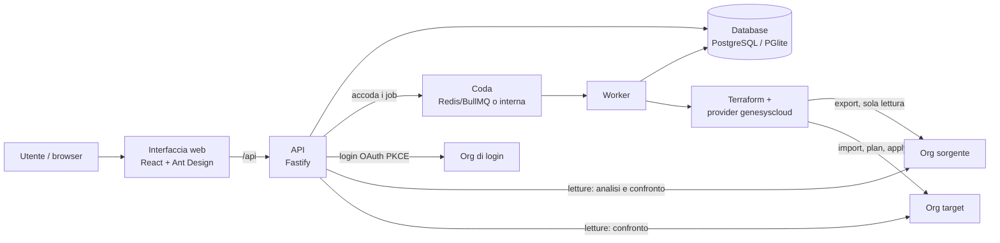
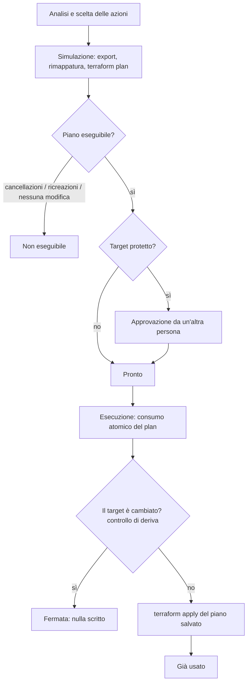

# Genesys Cloud Promote – Documento architetturale

Versione allineata al documento su Claude: https://claude.ai/artifact/KLzAb4mdnGFgyC41EqKgYb
(i diagrammi sono riportati qui in Mermaid).

Genesys Cloud Promote porta oggetti Genesys Cloud da un'org all'altra (dev → test → prod) solo attraverso un plan simulato, approvato se il target è protetto ed eseguito una sola volta. La Parte 1 mostra l'architettura in forma schematica; la Parte 2 la spiega componente per componente.

## Parte 1 – Architettura in sintesi

### Panoramica

L'applicazione legge gli oggetti da un'org sorgente, ne ricostruisce l'albero delle dipendenze, li confronta con un'org target e ne fa il porting con CX as Code (Terraform), sotto controllo di permessi e approvazioni.

| Attore | Cosa fa |
| --- | --- |
| Utente (consulente) | Analizza, sceglie cosa portare, crea la simulazione (plan) |
| Esecutore | Esegue un plan pronto (permesso *esegue*) |
| Approvatore | Approva i plan verso ambienti protetti; non può approvare i propri (permesso *approva*) |
| Org di login | Org Genesys usata solo per autenticare gli utenti |
| Org sorgente | Da dove si leggono ed esportano gli oggetti (sola lettura) |
| Org target | Dove gli oggetti vengono creati o aggiornati |

Ogni org è un **ambiente** dell'applicazione, con il proprio OAuth client. Un ambiente può essere *solo sorgente* (mai scritto) o *protetto* (plan con approvazione obbligatoria, tipicamente la produzione).

### Componenti



L'API legge le org per l'analisi e accoda i job; solo il worker esegue Terraform, legge dal sorgente e scrive sul target.

### Flusso di rilascio



Ogni rilascio passa da una simulazione salvata; l'esecuzione la applica una sola volta, dopo l'eventuale approvazione e solo se il target non è cambiato. Stati del plan: *In corso*, *Fallita*, *Non eseguibile*, *Da approvare*, *Pronto*, *Già usato*, *Scaduto*.

### Componenti e tecnologie

| Componente | Tecnologia | Responsabilità |
| --- | --- | --- |
| Interfaccia web | React, Vite, TypeScript, Ant Design, TanStack Query | Login, ambienti, wizard di porting con albero delle dipendenze, plan, storico; tabelle ordinabili per nome e tipo e filtrabili per tipo |
| API | Node.js 22, Fastify, TypeScript | Autenticazione, permessi, ambienti, analisi delle dipendenze, gestione dei job |
| Worker | Node.js, BullMQ (in locale: coda interna) | Esecuzione di simulazioni ed esecuzioni, un job alla volta |
| Motore di porting | Terraform + provider CX as Code `mypurecloud/genesyscloud` | Export dal sorgente, plan salvato, apply del plan sul target |
| Database | PostgreSQL + Drizzle ORM (in locale: PGlite) | Ambienti, job, plan cifrati, approvazioni, log, audit |
| Coda | Redis (solo in modalità server) | Passaggio dei job dall'API al worker |
| Platform API Genesys Cloud | REST | Letture per analisi e confronto, verifica delle credenziali |
| Login Genesys Cloud | OAuth 2.0 Authorization Code + PKCE | Identità e ruoli degli utenti |

Codice: monorepo [genesys-cloud-promote](https://github.com/ilrandagio/genesys-cloud-promote) con `apps/web` (interfaccia) e `apps/api` (API e worker).

## Parte 2 – Architettura in dettaglio

Ogni sezione descrive un aspetto dell'applicazione: cosa fa, come lo fa e quali garanzie offre.

### Autenticazione e autorizzazioni

Gli utenti entrano con il proprio account Genesys Cloud; cosa possono fare dipende dai ruoli Genesys letti al login.

**Login.** OAuth 2.0 Authorization Code con PKCE verso l'org di login, tramite un client di tipo *Code Authorization* (redirect `APP_URL/api/auth/callback`). State e verifier PKCE viaggiano in un cookie firmato valido 10 minuti. Dopo il login l'app legge il profilo e i ruoli (`/api/v2/users/me?expand=authorization`) ed emette una propria sessione: cookie JWT httpOnly di 8 ore. Il token Genesys dell'utente non viene conservato.

**Accesso.** Facoltativamente limitato a un ruolo Genesys (`GENESYS_LOGIN_REQUIRED_ROLE`) e/o a un elenco di email (`APP_ALLOWED_EMAILS`).

**Permessi di rilascio.** Calcolati al login e salvati nella sessione:

| Azione | Chi può farla |
| --- | --- |
| Analisi e simulazione | Qualunque utente autenticato |
| Esecuzione di un plan | Ruolo `GENESYS_APPLY_ROLE` o email in `APP_APPLY_EMAILS` (se entrambi vuoti: tutti) |
| Approvazione | Ruolo `GENESYS_APPROVER_ROLE` o email in `APP_APPROVER_EMAILS` (se entrambi vuoti: tutti), mai chi ha creato il plan |

Una modifica dei ruoli in Genesys vale dal login successivo. Lo stato di ogni plan e le azioni consentite all'utente sono calcolati dal server, che ricontrolla tutto a ogni richiesta: l'interfaccia mostra soltanto ciò che il server permette.

### Ambienti

Ogni org Genesys è registrata una sola volta, con il suo OAuth client *Client Credentials*: tutte le letture e scritture sulle org passano da questi client, non dall'utente collegato.

- **Nome**: è lo short name dell'org (`thirdPartyOrgName`, unico in Genesys Cloud), letto da `/api/v2/organizations/me` quando le credenziali vengono verificate. Non si digita, e la stessa org non può essere registrata due volte.
- **Verifica**: a ogni salvataggio l'app fa login con le credenziali; se fallisce, l'ambiente non viene salvato.
- **Secret**: cifrato AES-256-GCM con `ENCRYPTION_KEY`, mai restituito dalle API, nemmeno cifrato.
- **Solo sorgente**: un ambiente con *Utilizzabile come target* spento non può mai ricevere modifiche.
- **Protetto**: *Richiede approvazione* rende obbligatoria l'approvazione a 4 occhi per ogni plan verso quell'ambiente.
- **Regioni**: il dominio (es. `mypurecloud.de`) determina gli indirizzi di API e login e la regione passata al provider Terraform.

Ruoli consigliati per i client: lettura su Architect, Routing e Integrations per il sorgente; anche creazione, modifica e pubblicazione per il target, su tutte le Divisions coinvolte.

### Analisi delle dipendenze

L'analisi legge direttamente la Platform API (nessuno stato, nessuna scrittura) e costruisce l'albero completo: ogni oggetto trovato viene analizzato a sua volta, fino a 12 livelli.

| Oggetto | Da dove vengono le sue dipendenze |
| --- | --- |
| Flow | Dependency Tracking API **più** configurazione del flow (`latestconfiguration`), unite |
| Script | JSON completo dello script (export), ricerca degli ID |
| Queue | In-queue Flow, Whisper Prompt, ACD Skills del bullseye, Wrap-up Codes, più ogni oggetto noto citato per ID (Skill Expression Groups, Groups e Work Teams degli anelli del bullseye, Scripts…); i membri della Queue esclusi |
| Data Action | Integration |
| Schedule Group | Schedule |
| Skill Expression Group | ACD Skills e Languages citati per nome nelle condizioni (`skillConditions`) |
| Group | Roles assegnati al Group (grants), più gli ID citati nel dettaglio |
| Canned Response Library | Le sue Canned Responses, come oggetti *contenuti*: sono loro a usare la Library, quindi nell'ordine di creazione vengono dopo |

**Riconoscimento dei riferimenti.** Nel testo di una configurazione si cercano:

1. **ID**, anche con prefisso (`custom_-_<guid>` delle data action), confrontati con un indice degli oggetti dell'org sorgente costruito una volta per analisi;
2. **nomi esatti**: nei flow i riferimenti sono per nome, quindi vale qualunque tipo, anche come chiave di un blocco e nella forma `Prompt.<nome>`; le espressioni Architect (`Flow.`, `Task.`, `State.`…) sono ignorate. Negli script il nome vale solo se univoco e per i tipi principali. Due oggetti con lo stesso nome e tipo diverso (es. un Workflow e un Secure Flow) non si confondono: un omonimo trovato solo per nome viene scartato se lo stesso nome è già stato trovato con certezza (Dependency Tracking API o ID nella configurazione), e nell'export Terraform il flow viene scelto dall'etichetta che contiene il tipo (`WORKFLOW_<nome>`, `SECURECALL_<nome>`), mai da quella di un omonimo di un altro tipo.

Gli ID interni (pagine, componenti, task, azioni, variabili) e l'oggetto stesso non sono mai dipendenze.

#### Scripts: riconoscimento e mapping degli ID

Uno Script agente cita gli oggetti dell'org per **ID**, scritti nel suo JSON: nelle azioni (es. "Execute Data Action", trasferimenti e callback verso una Queue), nei valori iniziali delle variabili, nelle impostazioni. Il mapping verso il target funziona in quattro passi.

1. **Indice del sorgente.** All'inizio dell'analisi l'app legge dall'org sorgente l'elenco completo degli oggetti dei tipi elencati sotto e costruisce una tabella *ID → tipo e nome* (una volta per analisi). Gli ID Genesys sono univoci: un ID corrisponde a un solo oggetto, senza ambiguità di tipo.
2. **Ricerca nello Script.** Nel JSON completo dello Script (export) si prendono tutte le stringhe con la forma di un ID: GUID, oppure `custom_-_<GUID>` per le Data Actions personalizzate e `static…` per quelle predefinite. Ogni ID presente nell'indice diventa una dipendenza dello Script nell'albero; gli ID che non sono nell'indice (pagine, componenti, variabili, azioni dello Script) vengono ignorati.
3. **Abbinamento con il target.** Ogni dipendenza è cercata sul target per nome; l'azione scelta decide cosa scrivere al posto dell'ID.
4. **Sostituzione nel file.** In simulazione, nel file JSON dello Script esportato: ID del target per gli oggetti *Usa quella del target*; segnaposto `{{gcp_N}}` riempito da Terraform (`substitutions`) per gli oggetti *Porta*, creati nello stesso rilascio; nessuna sostituzione per lo Script stesso. Il log della simulazione elenca ogni sostituzione: tipo e nome dell'oggetto, ID del sorgente, ID del target (oppure "creato in questo rilascio") e numero di occorrenze.

**Oggetti cercati nell'indice (per ID):**

| Area | Tipi |
| --- | --- |
| Architect | Flow, Schedule, Schedule Group, User Prompt, Script, Data Table, Emergency Group |
| Routing | Queue, ACD Skill, Wrap-up Code, Language, Skill Expression Group |
| Integrations | Data Action, Integration |
| Outbound | Campaign, Messaging Campaign, Campaign Sequence, Contact List, Contact List Filter, DNC List, Call Analysis Response Set, Rule Set, Digital Rule Set, Campaign Rule, Attempt Limit, Callable Time Set, File Specification Template |
| Messaging | Messenger Configuration, Messenger Deployment, Supported Content |
| Canned Responses | Canned Response Library, Canned Response, Canned Response Asset |
| People & Permissions | Group, Work Team, Role; Divisions abbinate per nome |

Negli Scripts compaiono in pratica soprattutto **Data Actions** e **Queues**, a volte **Wrap-up Codes**, altri **Scripts**, **Data Tables** e, negli Scripts outbound, **Contact Lists** e **Campaigns**. Per **Data Action, Data Table, Flow, Emergency Group e Schedule Group** il riconoscimento avviene anche per **nome esatto**, se il nome è univoco nell'org; il nome serve solo all'albero, nel file si sostituiscono soltanto gli ID.

**ID nelle variabili.** Un ID scritto per intero come valore di una variabile (es. l'ID di una Data Table passato come input a "Get row details from data table") è riconosciuto e sostituito come gli altri. Per valori che cambiano tra ambienti e non sono oggetti portabili, il modello consigliato è una **Data Table di configurazione** con lo stesso nome in ogni ambiente, letta dallo Script con una Data Action e portata **senza dati**, così ogni ambiente conserva i propri valori; in alternativa, la variabile contiene il nome dell'oggetto e lo Script ricava l'ID a runtime.

**Cosa non viene riconosciuto:** ID di tipi che il client OAuth del sorgente non può leggere (avviso "Tipi di oggetto non leggibili" con il permesso mancante); ID di oggetti eliminati dal sorgente; tipi non gestiti (utenti, Sites, Edge Groups); ID composti a runtime o letti da fonti esterne. Se nella configurazione resta l'ID di un oggetto dell'indice che non compare nell'analisi, la simulazione si ferma e indica oggetto e risorsa.

**Albero.** Un oggetto presente in più rami mostra ovunque tutte le sue dipendenze, letto e confrontato una sola volta; il ramo si ferma solo per una dipendenza circolare. I nodi non leggibili (permessi, oggetto non trovato) restano nell'albero con il motivo, senza interrompere l'analisi.

**Confronto con il target.** Abbinamento per nome (per i flow anche per tipo di flow). Nomi con spazi all'inizio o alla fine: l'abbinamento con il target li ignora ("Schedule X " sul sorgente = "Schedule X" sul target). Se il nome esatto sul target è diverso (spazi, maiuscole), in simulazione i riferimenti nei file YAML dei Flows portati vengono riscritti con il nome del target, altrimenti la pubblicazione fallirebbe con "could not find the 'schedule group' by name". Un oggetto da creare con spazi nel nome dà un avviso. Il JSON viene normalizzato (via ID, date, versioni, GUID e, per le Data Actions, gli URI di template e schemi dell'org: `requestTemplateUri`, `successTemplateUri`, `inputSchemaUri`, `errorSchemaUri`, `successSchemaUri`); per le Integrations, spesso create o sistemate a mano sul target, non si confrontano le note e lo stato a runtime (`reportedState`, `lastUpdated`) e confrontato: *Mancante*, *Presente uguale*, *Presente diverso* con l'elenco dei campi, *Presente* quando il contenuto non è confrontabile (flow, script). I campi diversi sono indicati con il percorso completo (es. `config.request.requestUrlTemplate`); l'icona *Differenze* nell'analisi mostra il confronto riga per riga dello stesso contenuto normalizzato (`GET /api/compare`).

**Divisions.** Mostrate per ogni oggetto (`*` = nessuna divisione); con *Includi divisioni* diventano nodi con un'azione propria. Nel porting gli ID delle divisioni vengono comunque abbinati per nome.

**Azioni.** Per ogni oggetto distinto: *Porta* (crea o sovrascrive) oppure, in alternativa, *Usa quella del target* se l'oggetto esiste già sul target, *Salta* se manca (i riferimenti a quell'oggetto restano scoperti e vengono segnalati). Per un oggetto presente sul target "Salta" e "Usa quella del target" avrebbero lo stesso effetto, quindi non sono mai proposte insieme. Accanto a *Simula* un filtro mostra l'elenco dei soli oggetti con una certa azione, una riga per oggetto. La selezione e le scelte restano salvate nella sessione del browser.

**Elenco degli oggetti.** Oltre alla ricerca per nome, un filtro per Division (per i tipi che la prevedono, con l'opzione "Nessuna divisione") e l'interruttore *Solo selezionati*, che mostra gli oggetti selezionati di tutti i tipi con la colonna Tipo. Nell'albero, accanto a ogni oggetto, un'icona apre il dettaglio letto dal sorgente e, se l'oggetto esiste sul target, una seconda icona (arancione) quello letto dal target.

### Tipi supportati e regole di sicurezza

Il catalogo comprende 41 tipi, raggruppati nel selettore dell'interfaccia. Per i tipi che non hanno un'analisi dedicata (Outbound, Messaging, Canned Responses) le dipendenze si ricavano cercando nel dettaglio dell'oggetto gli ID degli oggetti noti dell'org sorgente.

| Gruppo | Tipi |
| --- | --- |
| Architect | Flows, Flow Outcomes, Flow Milestones, Schedules, Schedule Groups, User Prompts, Scripts, Data Tables, Emergency Groups, Triggers |
| Routing | Queues, ACD Skills, Wrap-up Codes, Languages, Skill Expression Groups |
| Integrations | Integrations, Data Actions |
| Outbound | Campaigns, Messaging Campaigns, Campaign Sequences, Contact Lists, Contact List Filters, DNC Lists, Call Analysis Response Sets, Rule Sets, Digital Rule Sets, Campaign Rules, Attempt Limits, Callable Time Sets, File Specification Templates, Wrap-up Code Mappings |
| Messaging | Messenger Configurations, Messenger Deployments, Supported Content |
| Canned Responses | Libraries, Responses, Assets |
| People & Permissions | Divisions, Groups (con i Roles assegnati), Work Teams, Roles |

Durante la simulazione, dopo la selezione delle risorse, il worker applica regole fisse alla configurazione esportata:

- **Campaigns e Campaign Sequences spente**: `campaign_status` e `status` forzati a `off`; l'avvio sul target resta un'azione manuale.
- **Impostazioni legate all'org scelte sul target** (Campaigns, Queues e Data Actions): nell'analisi, sulla riga dell'oggetto da portare, si scelgono tra i valori del target Site ed Edge Group (Campaign; callback della Queue, proposti per nome), l'indirizzo email in uscita della Queue ed eventuale elenco completo (dominio + Email Route, proposti per parte prima della `@` uguale, perché i domini di solito cambiano tra org) e il numero in uscita (Queue: Calling Party Number; Campaign: Caller Address) e, per le Queues, gli indirizzi di messaggistica in uscita (numero SMS, WhatsApp, Open Messaging), facoltativi. Se l'oggetto esiste già sul target si propongono i suoi valori attuali (Site, Edge Group, indirizzi email, numero); altrimenti Site ed Edge Group per nome, indirizzi per parte prima della @ e numero da inserire a mano. Gli elenchi del target non leggibili (es. permessi mancanti) sono segnalati nell'analisi; il numero è obbligatorio per le Campaigns che lo avevano, per le Queues vuoto significa nessun numero. Senza le scelte obbligatorie la simulazione non parte; il worker verifica che i valori esistano sul target e li scrive al posto di quelli del sorgente. Per le Data Actions si scelgono l'URL (`request_url_template`) e gli header con valore costante, proposti dalla Data Action del target se esiste, altrimenti dal sorgente; il worker li scrive dopo il ripristino dell'URL e la rimappatura degli ID, proteggendo `${` e `%{`. Gli header con template (`${credentials...}`, `${input...}`) restano quelli del sorgente; le Function Data Actions non hanno URL.
- **Membri delle Queues mai portati né toccati**: `members`, Groups, Teams e Skill Groups non vengono esportati. Sul target la Queue ha `ignore_members = true`, quindi i membri presenti restano; Groups, Teams e Skill Groups sono quelli del target se la Queue esiste già, nessuno se è nuova. Gli indirizzi di messaggistica in uscita (SMS, WhatsApp, Open Messaging) si scelgono sul target nell'analisi (proposto il valore attuale del target, vuoto = nessuno); senza una scelta restano quelli del target.
- **Groups e Roles assegnati**: i membri dei Groups (`member_ids`, `owner_ids`) non vengono esportati e sul target restano quelli presenti. I Roles assegnati al Group sul sorgente, con le loro Divisions, vengono assegnati anche sul target con `genesyscloud_group_roles`, costruito dal worker dai grants del sorgente: Role riusato o portato nello stesso rilascio, Division abbinata per nome (`*` = tutte). Le assegnazioni del Group sul target vengono sostituite da quelle del sorgente; un Group senza Roles sul sorgente non tocca quelle del target. Un Role o una Division non disponibili sul target fermano la simulazione con l'elenco.
- **Roles e licenze del target**: il target può avere licenze diverse dal sorgente (es. sviluppo CX3, target CX1). In simulazione il worker legge i permessi disponibili sul target (`GET /api/v2/authorization/permissions`) e confronta ogni permesso `domain:entity:action` dei Roles portati (un `*` vale se il domain o l'entity esistono sul target). Un permesso non disponibile **ferma la simulazione** con l'elenco. Con l'opzione **"Porta senza i permessi non disponibili"** sulla riga del Role, quei permessi vengono tolti (una policy senza più action viene tolta intera): ogni rimozione compare nel log e negli avvisi del plan ("Da leggere prima di approvare"). Se in seguito il target ottiene le licenze, i permessi si aggiungono rifacendo il porting del Role.
- **Data Actions con contract cambiato**: il provider non può aggiornarle e le ricrea (cancella e crea, nuovo ID). Il plan è bloccato finché sulla riga della Data Action non si attiva *Consenti la ricreazione*; la scelta è per oggetto. Con l'opzione, il plan elenca negli avvisi chi la usa sul target (Dependency Tracking): gli oggetti portati nello stesso rilascio ricevono il nuovo ID, gli altri restano con quello vecchio e vanno portati o ripubblicati. Il ripristino la ricrea com'era prima.
- **Scripts esistenti con nome duplicato sul target**: il provider aggiorna lo Script per ID ma poi lo ricerca per nome e si ferma se ne trova più di uno (problema noto del provider). La simulazione lo verifica prima e si ferma con gli ID delle copie, da rinominare o eliminare sul target.
- **Flow Outcomes e Flow Milestones**: sono citati dai Flows (azioni *Initialize/Set Flow Outcome* e *Set Flow Milestone*) e compaiono come loro dipendenze; si portano con nome, descrizione e Division, o si usa quello del target con lo stesso nome. Portati nello stesso rilascio, vengono creati prima dei Flows che li usano.
- **Triggers (Process Automation)**: si portano Topic, condizioni (`matchCriteria`), Data Format e tempi; il Workflow di destinazione è una dipendenza e viene portato o abbinato per nome come gli altri Flows. Gli ID citati nelle condizioni (es. Queue, Campaign) vengono rimappati sugli oggetti del target; un ID non riconosciuto, come un utente, ferma la simulazione, perché sul target la condizione non scatterebbe mai.
- **Gli utenti non si portano mai**: né come membri od owner di Groups e Queues, né come assegnatari dei Roles. Un Role con una condizione su un utente specifico ferma la simulazione, perché l'ID dell'utente è diverso sul target.
- **Dati delle Data Tables (opzionale)**: di default si porta solo la struttura. Con *Porta anche i dati (righe)* le righe del sorgente diventano risorse `genesyscloud_architect_datatable_row`; quelle con la stessa chiave sul target vengono importate con blocchi `import` (un solo plan) e aggiornate, quelle presenti solo sul target restano invariate. I valori sono copiati così come sono, senza rimappare eventuali ID scritti nelle celle. Richiede Terraform 1.5 o successivo.
- **URL delle Data Actions**: il provider 1.88.0 toglie dall'export `config_request.request_url_template` di tutte le Data Actions (voleva farlo solo per le Function Data Actions) e la creazione sul target fallisce. Il worker lo rilegge dal sorgente e lo rimette, proteggendo `${` e `%{` dei template; le Function Data Actions restano senza, perché lo imposta la piattaforma.
- **Data Actions predefinite di Genesys** (statiche, ID `static…`, tag *predefinita*): esistono in ogni org con la loro Integration e non si possono creare né modificare; l'export le scrive come data source, non come risorse. Non si portano: si usa quella del target (azione *Porta* non disponibile, rifiutata anche da API e worker).
- **Contact Lists senza contatti**: si porta la struttura (colonne, numeri, Attempt Limit), i dati dei contatti non escono dal sorgente.
- **Canned Response Assets**: il file viene scaricato dal sorgente e caricato sul target. I link all'asset nel testo delle Responses vengono riscritti per intero: con l'URL dell'asset sul target, letto in simulazione, se l'asset è riusato; con il riferimento Terraform `content_location` se l'asset viene caricato nello stesso rilascio, che così avviene prima della Response.
- **Messenger Deployment**: punta alla versione della Messenger Configuration creata nello stesso rilascio oppure all'ultima versione pubblicata sul target; se non ce n'è nessuna la simulazione si ferma.
- **Wrap-up Code Mappings** (oggetto unico per org): non vengono sovrascritti ma uniti. Il worker non li esporta: costruisce la configurazione partendo dalla mappatura del target e applica i flag dei Wrap-up Codes del sorgente, così le associazioni presenti solo sul target restano e il Default Set resta quello del target. Se un Wrap-up Code della mappatura del sorgente non è sul target e non viene portato nello stesso rilascio, la simulazione si ferma con l'elenco per nome.

Queste regole sono collaudate con org simulate; il download e caricamento degli asset, l'allineamento delle versioni del Messenger e i Wrap-up Code Mappings vanno verificati su org reali.

### Simulazione (plan)

La simulazione prepara e salva esattamente ciò che verrà scritto sul target, senza scrivere nulla; il worker la esegue in una cartella di lavoro temporanea.

1. **Export dal sorgente** (sola lettura): `genesyscloud_tf_export` limitato agli oggetti con azione *Porta*, formato JSON, risoluzione automatica delle dipendenze disattivata (le dipendenze le ha decise l'utente), nuovo esportatore dei flow (scrive i file YAML). La cartella è indicata con un percorso relativo, necessario su Windows.
2. **Selezione delle risorse**: dall'export si tengono solo gli oggetti scelti; se un oggetto manca, o un suo file (YAML del flow, JSON dello script) non è stato esportato, la simulazione si ferma con l'elenco.
3. **Rimappatura degli ID**, risorsa per risorsa e mai sulla risorsa stessa né sui percorsi dei file:
   - dipendenze *Usa quella del target* e divisioni (per nome) → ID del target;
   - oggetti portati nello stesso job → riferimento Terraform `${risorsa.id}`;
   - ID scritti nei file esportati (JSON degli script, YAML dei flow) → ID del target, oppure segnaposto `{{gcp_N}}` riempito da Terraform con `substitutions` per gli oggetti creati nel job.
4. **Ordine di creazione**: ogni arco dell'albero (A usa B) tra oggetti portati diventa un `depends_on`; un ciclo emerge qui, non durante l'esecuzione.
5. **Controlli**: le voci TTS dei Flows (blocchi `textToSpeech` nei file YAML esportati, per lingua) devono esistere sul target (`/api/v2/tts/engines`), altrimenti la pubblicazione fallirebbe a metà esecuzione; Divisions referenziate ma assenti sul target bloccano la simulazione; anche un riferimento a un oggetto che non esiste sul target e non viene portato (azione *Salta*) ferma la simulazione con l'elenco, invece di far fallire l'esecuzione. Due controlli coprono un'analisi non più attuale: un oggetto da creare che nel frattempo esiste sul target (per esempio creato da un'esecuzione precedente) e un ID di un oggetto del sorgente rimasto nella configurazione perché non compare nell'analisi; in entrambi i casi la simulazione si ferma e chiede di rifare l'analisi. **Bot Connector nei Flows**: le azioni *Call Bot Connector* citano integration, bot e versione per nome (`botIntegration: <integration>: <bot>: <versione>`), che di solito cambiano tra ambienti (es. `ChatBot_ISPS_test` v2 in sviluppo, `ChatBot_ISPS` v5 in produzione). Nella pagina Ambienti, sull'ambiente target, il pulsante *Bot Connector* imposta le regole di sostituzione (integration sorgente facoltativa, bot sorgente, versione sorgente o tutte → integration, bot e versione del target; i valori del target sono proposti leggendo l'org). In simulazione le regole vengono applicate ai file YAML dei Flows portati e ogni riferimento è verificato sul target (`/api/v2/integrations/botconnector/{id}/bots`): un bot o una versione assenti fermano la simulazione con i valori disponibili; bot non leggibili danno solo un avviso.
6. **Import** degli oggetti già presenti sul target nello state locale (sola lettura), così vengono aggiornati e non duplicati.
7. **Piano salvato**: `terraform plan -out`, poi `terraform show -json` per il riepilogo (da creare, aggiornare, cancellare, ricreare, già uguali sul target: un oggetto scelto ma identico sul target compare come "già uguale", non sparisce dal riepilogo).
8. **Blocco**: un piano che cancella o ricrea oggetti, o che non contiene modifiche, è *non eseguibile* (ricreare un oggetto ne cambia l'ID). Unica eccezione decisa dall'utente: la ricreazione di una Data Action con *Consenti la ricreazione*, con l'elenco di chi la usa sul target negli avvisi.
9. **Artefatto**: la cartella di lavoro completa (configurazione, file, state, piano, lock dei provider) e l'identità del target vengono salvate **cifrate nel database** insieme al plan, valide `PLAN_TTL_HOURS` ore (24 di default). La cartella temporanea viene cancellata.
10. **File scaricabili**: separatamente, cifrati e senza scadenza, si salvano la configurazione per il target e i file referenziati, l'output del plan e il riepilogo; *File del plan* li scarica in `.tar.gz` (`GET /api/jobs/:id/plan-files`). Esclusi state, tfvars e file di piano binari, che contengono i valori attuali del target.

### Approvazione ed esecuzione

L'esecuzione applica il piano salvato una sola volta, e solo se nel frattempo il target non è cambiato.

**Approvazione** (solo target protetti). Un utente con il permesso *approva*, diverso da chi ha creato il plan, approva con un aggiornamento condizionale: il plan deve essere completato, non bloccato, non scaduto, non già eseguito né approvato.

**Richiesta di esecuzione** (API, in un'unica transazione):

1. il plan viene *consumato* con un aggiornamento condizionale (completato, non bloccato, artefatto presente, non scaduto, non già eseguito);
2. si verificano target abilitato e approvazione, se richiesta;
3. viene creato il job di esecuzione collegato al plan; un indice univoco sul database impedisce un secondo job per lo stesso plan, anche con richieste simultanee.

Se la transazione non riesce, l'API risponde con il motivo preciso (già eseguito, scaduto, da approvare…).

**Esecuzione** (worker):

1. il job passa da *in coda* a *in corso* solo se nessun altro processo l'ha già preso;
2. il worker ricontrolla stato del plan, assegnazione, scadenza, approvazione e target abilitato;
3. ricrea la cartella del plan dall'artefatto e verifica che l'ambiente target abbia ancora la stessa identità (id, nome, regione, client);
4. **controllo di deriva**: ricalcola il piano sul target e lo confronta con quello salvato (azioni e valori prima/dopo per ogni risorsa); se differiscono non applica nulla e indica gli oggetti cambiati;
5. **stato precedente per il ripristino**: esporta dal target (sola lettura) gli oggetti che il plan aggiorna, con gli stessi accorgimenti della simulazione (URL delle Data Actions, membri e indirizzi delle Queues, Campaigns spente), e lo salva cifrato; Wrap-up Code Mappings, Roles dei Groups e righe delle Data Tables si salvano dai valori precedenti del piano. Un oggetto che l'export del target non restituisce (per esempio uno Script non pubblicato) viene segnalato nel log e negli avvisi del ripristino come non ripristinabile, e l'esecuzione prosegue; se invece l'export non riesce, l'esecuzione si ferma senza scrivere;
6. `terraform apply` del piano salvato, senza riesportare dal sorgente;
7. registra le risorse effettivamente scritte e, dallo state, quelle create, anche se l'esecuzione si interrompe a metà;
8. cancella l'artefatto: il plan non è più eseguibile.

Un'esecuzione fallita lascia il plan consumato: si rifà la simulazione, che riparte dallo stato reale del target. Nell'interfaccia *Approva*, *Esegui il plan* e *Scarta* chiedono conferma.

**Ripristino.** Su un'esecuzione, *Ripristina lo stato precedente* crea una *simulazione di ripristino* (`POST /api/jobs/:id/rollback`): la configurazione salvata prima della scrittura viene importata dal target con gli ID attuali, così gli oggetti aggiornati tornano com'erano; gli oggetti creati dall'esecuzione entrano nello state senza configurazione, così il piano li cancella. È l'unico caso in cui un piano può cancellare, e solo quegli oggetti: ricreazioni e altre cancellazioni restano bloccate. Poi approvazione, controllo di deriva ed esecuzione come per ogni plan. Non si ricreano oggetti cancellati, Campaigns e Sequences restano spente, e gli oggetti tornano allo stato precedente anche se modificati dopo l'esecuzione (indicato negli avvisi del plan).

**Note di rilascio.** Per ogni esecuzione, *Note di rilascio* genera un documento Markdown (`GET /api/jobs/:id/release-notes`): esito, chi ha simulato, approvato ed eseguito e quando, oggetti portati e del target usati, modifiche con l'indicazione di quelle applicate, avvisi letti all'approvazione e log completo.

### Disaster Recovery e Backup

**Disaster Recovery.** Il tab *Disaster Recovery* usa la stessa pagina del porting in una modalità dedicata, con scelte e analisi separate nella sessione. Al passo 2, invece dei singoli oggetti, si scelgono i tipi da portare: per ciascuno *Tutti* gli oggetti (esclusi Data Actions predefinite e Flows mai pubblicati, che non si esportano) oppure *Scegli*, con l'elenco degli oggetti del tipo. I preset *Configurazione minima* (Flows con Outcomes e Milestones, Queues, Skills, Languages, Wrap-up Codes, Schedules, Schedule Groups, Emergency Groups, Prompts, Data Tables, Integrations, Data Actions, Scripts), *Tutto* e *Nessuno* sono un punto di partenza da modificare. L'analisi trova anche le dipendenze dei tipi non scelti: quelle presenti sul target vengono usate, quelle mancanti portate, e si può cambiare al passo 3. Da lì in poi tutto è identico al porting: impostazioni del target, simulazione, approvazione, esecuzione, ripristino e note di rilascio.

**Tipi Terraform generici.** Lo schema del provider (1.88) ha 161 risorse; 41 sono nel catalogo, con analisi delle dipendenze, confronto e regole per tipo. Delle altre, tolte quelle che non sono configurazione da portare a sé (`tf_export`, `bcp_tf_exporter`, righe delle Data Tables e Roles dei Groups, già gestite dentro i loro tipi), 116 si possono scegliere nel Disaster Recovery come *tipi interi* (`GET /api/terraform-types`, con gruppo e avvisi: legato all'ambiente, sicurezza, utenti, dati). Per questi tipi il worker usa un motore generico basato solo sull'export di Terraform: esporta tutti gli oggetti del tipo dal sorgente con lo state (ID sorgente), esporta gli stessi tipi dal target (sola lettura) e abbina per etichetta, che l'exporter ricava dal nome con le stesse regole su entrambe le org; le risorse presenti sul target vengono importate, quindi aggiornate, le altre create. I riferimenti tra risorse esportate insieme sono già riferimenti Terraform, gli ID sorgente degli oggetti generici diventano riferimenti nello stesso job e quelli degli oggetti del catalogo seguono la rimappatura normale (con il controllo sugli oggetti citati ma non analizzati). Controlli: variabili dell'export senza valore (segreti non esportabili, per esempio credenziali) fermano la simulazione con l'elenco; ID rimasti senza corrispondenza sul target, tipi con valori legati all'ambiente (copiati così come sono), tipi di sicurezza o utenti e tipi di dati compaiono negli avvisi del plan. Restano valide le regole del piano: nessuna cancellazione né ricreazione, approvazione per i target protetti, controllo di deriva. Il ripristino automatico non riporta indietro le risorse dei tipi generici (indicate come non ripristinabili). Il provider non ha una risorsa per gli *scheduled triggers* di Process Automation: per ora non si portano. Con molti oggetti l'analisi può durare minuti: il proxy nginx del container attende fino a 900 secondi (eventuali proxy davanti, come il Koa, vanno allineati).

**Backup.** Il tab *Backup* crea un job `BACKUP` in sola lettura. *Completo* (predefinito): `genesyscloud_tf_export` senza filtri né attributi esclusi, quindi tutto ciò che il provider sa esportare, utenti, membri, telefonia e sicurezza compresi: un backup esatto dell'org. *Selezione*: si sceglie l'ambiente e, con la stessa selezione per tipo, cosa salvare (tutti gli oggetti di un tipo diventano un filtro `tipo::.*` dell'export), senza membri di Queues, Groups e Work Teams. In entrambi i casi l'export include lo state (ID degli oggetti); il worker aggiunge `BACKUP.json` (ambiente, data, autore, versione del provider, scelta, conteggi), crea l'archivio `.tar.gz` e lo cifra in streaming con AES-256-GCM in `BACKUP_DIR` (con Docker il volume `backups`, condiviso da API e worker). Il download (`GET /api/jobs/:id/backup`) decifra al volo e fallisce se il file è stato alterato. Si conservano gli ultimi `BACKUP_KEEP` backup completati (predefinito 30): gli archivi più vecchi vengono cancellati e restano nello storico come *cancellati*. Il backup non passa da simulazione né approvazione perché non scrive sulle org.

### Modello dati e sicurezza dei dati

Due tabelle reggono tutto; i dati sensibili sono cifrati e non escono mai dal server.

| Tabella | Contenuto principale |
| --- | --- |
| `environments` | Short name, regione, client ID, secret cifrato, *solo sorgente*, *richiede approvazione*, regole Bot Connector (`bot_mappings`) |
| `jobs` | Simulazioni ed esecuzioni: oggetti e azioni scelti, archi dell'albero, log, output e riepilogo del piano, motivo di blocco, artefatto cifrato, file scaricabili cifrati, scadenza, approvatore, collegamento plan ↔ esecuzione, risorse scritte, stato precedente cifrato per il ripristino, collegamento ripristino ↔ esecuzione, backup (scelta, archivio, conteggi), tipi Terraform generici, autore, date |

Le migrazioni dello schema sono versionate (Drizzle) e applicate all'avvio dell'API.

| Dato sensibile | Protezione |
| --- | --- |
| Client secret degli ambienti | AES-256-GCM con `ENCRYPTION_KEY`; mai restituito dalle API |
| Artefatto del plan (configurazione, state, variabili dell'export) | AES-256-GCM; mai restituito dalle API; cancellato dopo l'esecuzione o alla scadenza (controllo orario) |
| File scaricabili del plan e stato precedente per il ripristino | AES-256-GCM; i file del plan si scaricano solo da utenti autenticati, senza state né tfvars; lo stato precedente non esce mai dal server |
| Archivi dei backup | AES-256-GCM su disco (`BACKUP_DIR`), decifrati solo durante il download da utenti autenticati; conservati gli ultimi `BACKUP_KEEP` |
| Cartelle di lavoro Terraform | Temporanee, cancellate a fine job (`KEEP_WORKDIR=1` solo per diagnosi) |
| Credenziali passate a Terraform | Solo come variabili d'ambiente del processo, senza i segreti dell'app |
| Sessione utente | JWT firmato con `JWT_SECRET`, cookie httpOnly, 8 ore |

Perdere `ENCRYPTION_KEY` rende illeggibili secret e plan salvati: gli ambienti vanno reinseriti e le simulazioni rifatte.

### Modalità di esecuzione e deploy

Lo stesso codice gira in due configurazioni, scelte solo dalle variabili `DATABASE_URL` e `REDIS_URL`.

|  | Locale | Server / Docker |
| --- | --- | --- |
| Prerequisiti | Node.js 22, Terraform | Docker (o un runtime compatibile) |
| Database | PGlite integrato in `data/` (solo per provare) oppure PostgreSQL | PostgreSQL |
| Esecuzione dei job | Coda interna, nel processo dell'API | Worker separato, coda Redis (BullMQ) |
| Interfaccia | `npm run dev` → http://localhost:5173 | nginx → http://localhost:8080, `/api` verso l'API |
| Avvio | `npm run setup` poi `npm run dev` | `docker compose up --build` |

Con Docker l'interfaccia può essere pubblicata anche su un percorso di un altro server (es. `https://server/promote`, dietro un server già esposto sulla 443): l'interfaccia viene compilata con il prefisso (`BASE_PATH`), il server davanti inoltra le richieste togliendo il prefisso e `APP_URL` lo include, così anche il Redirect URI del login (`APP_URL/api/auth/callback`). Con `WEB_BIND=127.0.0.1` la porta del container non è raggiungibile dall'esterno.

In entrambi i casi un solo job alla volta: niente esecuzioni concorrenti sullo stesso target. L'immagine del worker include Terraform; il provider Genesys viene scaricato secondo `GENESYS_PROVIDER_VERSION` (default `>= 1.88.0`, la prima versione supportata) e l'esecuzione usa la versione registrata nel lock salvato nel plan, quindi la stessa della simulazione. Con `>=` ogni simulazione usa l'ultima release disponibile; per bloccare una versione basta indicarla esatta (es. `1.88.0`).

**Configurazione (`.env`).** Segreti dell'app (`JWT_SECRET`, `ENCRYPTION_KEY`), `APP_URL`, client di login (`GENESYS_LOGIN_*`), regole di accesso e di rilascio (`GENESYS_APPLY_ROLE`, `GENESYS_APPROVER_ROLE`, elenchi email, `PLAN_TTL_HOURS`), database e coda.

**Database integrato.** PGlite non sopporta chiusure brusche del processo: l'app chiude in modo ordinato su Ctrl+C e stop, ma per plan, approvazioni e storico che devono durare va usato PostgreSQL (installabile anche su Windows senza Docker).

#### Installazione con Docker: procedura

Procedura per un server Linux con Docker. Gli esempi pubblicano l'app su `https://<server>/promote` dietro un server
Node/Koa già in ascolto sulla 443 (il caso del server di produzione). Le differenze per l'app esposta direttamente sono
indicate al passo 3.

**1. Prerequisiti sul server**

```bash
docker --version              # Docker Engine
docker compose version        # Compose v2
sudo docker run --rm hello-world
```

I comandi `docker` richiedono `sudo`, oppure un utente nel gruppo `docker`, che equivale a root. Per questo il
gruppo va dato solo agli amministratori.

**2. Pacchetto dei sorgenti** (dal PC, nella cartella del repository aggiornato)

```bash
git pull
git archive --format=tar.gz -o gcp.tar.gz HEAD \
  package.json package-lock.json docker-compose.yml .dockerignore .env.example apps
scp gcp.tar.gz ubuntu@<server>:~
```

`git archive` include solo i file versionati: niente `node_modules`, `.env` o `data`. La compilazione avviene dentro
Docker, quindi sul server non servono Node né Terraform. In alternativa al pacchetto si può fare `git clone` del
repository sul server.

Sul server:

```bash
mkdir -p ~/genesys-cloud-promote
tar -xzf ~/gcp.tar.gz -C ~/genesys-cloud-promote
cd ~/genesys-cloud-promote
```

La cartella deve chiamarsi sempre `genesys-cloud-promote`, perché Docker dà ai volumi del database il nome della
cartella (`genesys-cloud-promote_pgdata`).

**3. File `.env`** (solo alla prima installazione)

```bash
cp .env.example .env && chmod 600 .env
openssl rand -hex 32        # → JWT_SECRET
openssl rand -base64 32     # → ENCRYPTION_KEY (conservarla anche fuori dal server)
nano .env
```

| Variabile | Valore dietro il Koa | Note |
| --- | --- | --- |
| `JWT_SECRET` | 64 caratteri esadecimali | Cambiandolo si invalidano tutte le sessioni |
| `ENCRYPTION_KEY` | 32 byte in base64 | Se si perde, i client secret salvati non sono più decifrabili |
| `APP_URL` | `https://<server>/promote` | L'indirizzo esatto usato nel browser, senza barra finale |
| `WEB_PORT` | `8090` | Porta locale a cui il Koa inoltra; deve essere libera |
| `WEB_BIND` | `127.0.0.1` | La porta non è raggiungibile dall'esterno |
| `BASE_PATH` | `/promote` | Stesso prefisso del proxy; cambiandolo serve `--build` |
| `GENESYS_LOGIN_REGION` | es. `mypurecloud.de` | Regione dell'org del client di login |
| `GENESYS_LOGIN_CLIENT_ID` / `_SECRET` | client *Code Authorization* | Vedi il passo 4 |
| `APP_APPLY_EMAILS` / `APP_APPROVER_EMAILS` | email separate da virgola | Chi esegue e chi approva (in alternativa i Roles Genesys) |
| `DATABASE_URL`, `REDIS_URL` | vuoti | Li imposta `docker-compose.yml` |
| `GENESYS_PROVIDER_VERSION` | `>= 1.88.0` | |

Per l'app esposta direttamente, senza il Koa: `BASE_PATH` vuoto, `WEB_BIND` vuoto, `WEB_PORT` uguale alla porta
aperta sul firewall e `APP_URL=https://<server>:<porta>`.

Regole del file: una variabile per riga, nessuno spazio attorno a `=` e nessun `#` davanti. Se il file è stato
modificato su Windows, togliere i fine riga Windows con `sed -i 's/\r$//' .env`.

**4. Client OAuth di login in Genesys Cloud** (Admin → Integrations → OAuth, nell'org della regione indicata)

- Grant Type: **Code Authorization** (un client *Client Credentials* non funziona per il login).
- Authorized redirect URI: `APP_URL` + `/api/auth/callback`, identico carattere per carattere. Esempio:
  `https://<server>/promote/api/auth/callback`.

**5. Proxy nel server Koa** (`npm install koa-proxies`, da registrare prima del body parser e delle altre route)

```js
const proxy = require('koa-proxies');
app.use(async (ctx, next) => {
  if (ctx.path === '/promote') return ctx.redirect('/promote/');
  await next();
});
app.use(proxy(/^\/promote\//, {
  target: 'http://127.0.0.1:8090',   // 127.0.0.1, non "localhost" (Node può provare l'IPv6 ::1)
  changeOrigin: false,
  xfwd: true,
  rewrite: (p) => p.replace(/^\/promote/, ''),
  proxyTimeout: 900000,              // l'analisi di org grandi (Disaster Recovery) può durare minuti
}));
```

Il servizio Koa deve girare con un utente senza privilegi, non root e fuori dal gruppo `docker`, con
`AmbientCapabilities=CAP_NET_BIND_SERVICE` nell'unità systemd per poter aprire le porte 80 e 443.

**6. Compilazione e avvio**

```bash
sudo docker compose build          # controllare che termini senza errori
sudo docker compose up -d
sudo docker compose ps --format '{{.Service}}\t{{.Status}}\t{{.Ports}}'
```

Esito atteso: tutti i servizi `Up` (`postgres` anche `healthy`), con `web` su `127.0.0.1:8090->80/tcp`. I container
ripartono da soli dopo un riavvio del server. Gli archivi dei backup stanno nel volume `backups`; il backup del
volume `pgdata` (passo 9) non li include.

**7. Verifiche**

```bash
curl -s http://127.0.0.1:8090/ | grep -o 'src="[^"]*"'                          # src="/promote/assets/..."
curl -s -o /dev/null -w '%{http_code}\n' http://127.0.0.1:8090/api/auth/me      # 401
curl -sk https://localhost/promote/ | grep -o 'src="[^"]*"'                      # uguale, attraverso il Koa
curl -skI https://localhost/promote/api/auth/login | grep -io 'path=[^;]*'      # Path=/promote/api/auth
```

Poi dal browser: `https://<server>/promote/` → *Accedi con Genesys Cloud*.

**8. Aggiornamenti**

Si rifà il pacchetto (passo 2) e lo si estrae sopra la cartella esistente: il `.env` resta, perché il pacchetto non
lo contiene. Poi:

```bash
cd ~/genesys-cloud-promote
tar -xzf ~/gcp.tar.gz -C ~/genesys-cloud-promote
sudo docker compose build && sudo docker compose up -d
```

Se cambia solo il codice dell'API, basta `sudo docker compose build api worker && sudo docker compose up -d api worker`.
Se la compilazione sembra non aver preso le modifiche, ricompilare senza cache: `build --no-cache`.

**9. Backup e operazioni**

```bash
sudo docker compose exec -T postgres pg_dump -U gcp gcp > backup-$(date +%F).sql                # backup
sudo docker compose logs --tail=50 api                                                           # log dell'API
sudo docker compose logs --tail=50 worker                                                        # log dei job
```

`docker compose down` ferma l'app conservando i dati. `docker compose down -v` cancella anche il database: non
usarlo. Oltre al backup del database va conservato il `.env`, in particolare `ENCRYPTION_KEY`.

**10. Problemi frequenti**

| Sintomo | Causa | Soluzione |
| --- | --- | --- |
| `address already in use` all'avvio di `web` | La porta `WEB_PORT` è usata da un altro programma | Scegliere una porta libera (`sudo ss -ltnp \| grep :<porta>`) |
| `api` e `worker` in `Restarting`, nel log `ZodError` | Variabile del `.env` mancante o non valida (indicata in `path`) | Correggere il `.env`, poi `sudo docker compose up -d` |
| *Service Unavailable* dal Koa | Il Koa non raggiunge `127.0.0.1:<WEB_PORT>` | Controllare `WEB_BIND=127.0.0.1`, `WEB_PORT` e la destinazione del proxy |
| *502 Bad Gateway* su `/api/...` | `api` non è in esecuzione | `sudo docker compose logs api` |
| Pagina bianca | Interfaccia compilata senza prefisso (`src="/assets/..."`) | `BASE_PATH` nel `.env`, poi `build` |
| *The OAuth client ID or redirect URI is invalid* | Client di altra regione, non *Code Authorization*, o redirect URI diverso | Vedi il passo 4; l'URI inviato si legge con `curl -skI https://localhost/promote/api/auth/login` |
| *Sessione di login scaduta* | Il cookie di login non torna: `APP_URL` senza il prefisso, oppure immagine non aggiornata | `APP_URL` con `/promote`; verificare `Path=/promote/api/auth` (passo 7) |
| Dopo il login si torna alla pagina di login | Indirizzo nel browser diverso da `APP_URL`, oppure HTTP con `APP_URL` in HTTPS | Usare esattamente l'indirizzo di `APP_URL` |


### Garanzie di affidabilità

Ogni rischio di rilascio non voluto, non autorizzato o incoerente ha una contromisura nel codice, verificata con org e Terraform simulati.

| Rischio | Contromisura |
| --- | --- |
| Rilascio senza revisione | Nessuna esecuzione diretta: solo da un plan completato |
| Si applica qualcosa di diverso da ciò che è stato rivisto | Apply del piano salvato, nessun nuovo export dal sorgente |
| Il target cambia tra simulazione ed esecuzione | Controllo di deriva: piano ricalcolato e confrontato; se differisce non si scrive nulla |
| Stesso plan eseguito due volte (anche in parallelo) | Consumo atomico in transazione + indice univoco; collaudo: 5 richieste simultanee, 1 riuscita |
| Esecuzione non autorizzata | Permesso *esegue* dai ruoli Genesys, ricontrollato da API e worker |
| Rilascio in produzione senza seconda persona | Ambiente protetto: approvazione obbligatoria, mai da chi ha creato il plan |
| Plan vecchio eseguito per sbaglio | Scadenza (`PLAN_TTL_HOURS`) e possibilità di scartare |
| Credenziali del target cambiate verso un'altra org | Identità del target salvata nel plan e verificata all'esecuzione |
| Ricreazione di oggetti (cambio di ID) | Piani con cancellazioni o ricreazioni bloccati |
| Ordine di creazione sbagliato (flow prima delle dipendenze) | `depends_on` dagli archi dell'albero; cicli scoperti in simulazione |
| Errore a metà esecuzione | Risorse scritte registrate; plan consumato; nuova simulazione dallo stato reale |
| Riavvio durante un job | Job chiuso come fallito, mai ripreso in automatico |
| Doppia presa in carico di un job | Passaggio *in coda* → *in corso* condizionale |
| Dati sensibili esposti | Cifratura, nessun segreto nelle risposte API, pulizia automatica |

### Limiti noti ed evoluzioni

Il collaudo finora è stato fatto con org e Terraform simulati; il prossimo passo è una simulazione reale pbzdev → pbztest con Flows, Common Modules, Scripts e Data Actions.

- **Export Terraform**: è la parte più fragile (nomi delle risorse, formato dei file, versione del provider). Se continua a dare problemi, l'evoluzione prevista è generare la configurazione Terraform dall'app leggendo gli oggetti via API, mantenendo plan, controllo di deriva e apply.
- **Abbinamento per nome**: non distingue oggetti omonimi in divisioni diverse; un'etichetta interna di un flow uguale al nome di un oggetto viene presa per un riferimento (tag *per nome* nell'albero).
- **Data Tables**: di default viene portata la struttura; le righe solo su richiesta, senza rimappare eventuali ID nelle celle.
- **Una sola org di login** per istanza; le operazioni sulle org usano i client degli ambienti, non i permessi dell'utente collegato.
- **Database integrato**: solo per provare; PostgreSQL per l'uso continuativo.
- **Conferma rafforzata** per gli ambienti protetti (digitare il nome del target): possibile evoluzione.
- **Nome commerciale**: se lo strumento viene proposto ai clienti, evitare un nome che inizi con il marchio "Genesys".
